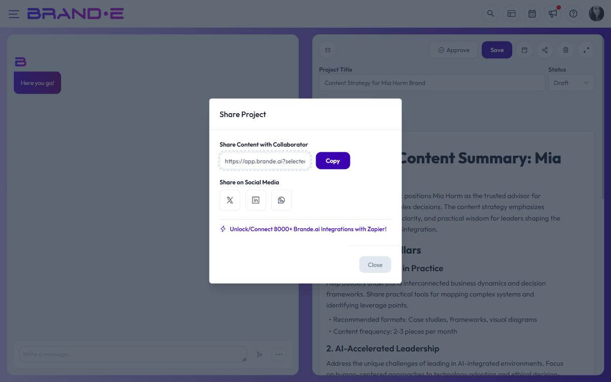

# Publish Content to Your Channels

Brande.ai doesn't post to social networks, blogs, or CMS platforms from inside the app. When your content is ready, you publish it from your own accounts using one of three routes:

1. **Copy or export** the content and post it yourself
2. **Share** it to X, LinkedIn, or WhatsApp from the project's Share window
3. **Automate** it with Zapier, using a Brande.ai API key

## Option 1: Copy or export

This is the most flexible route and works for any channel: your blog, newsletter tool, social scheduler, or CMS.

- **Copy:** Select the text in the document editor and paste it where you're publishing.
- **Export:** Click the download icon at the top of the document and choose **PDF** or **Word**. On desktop, the icon appears when you hover over the document. You'll see "Project will be exported shortly." See [Export Content to DOCX or PDF](/section-5-projects-organization/export-content).
- **Tables:** Use **Download CSV** to export a table. See [Export Tables to CSV](/section-5-projects-organization/export-tables-csv).

## Option 2: Share to X, LinkedIn, or WhatsApp

1. Open the project and click **Share** (network icon) in the project toolbar.
2. Under **Share on Social Media**, click **X (Twitter)**, **LinkedIn**, or **WhatsApp**.
3. The platform opens in a new tab with your project's text filled in.
4. Edit the post if needed, then post it from that platform.

Only the text is sent. Images aren't included, so add any images on the platform before posting.

## Option 3: Automate with Zapier

The Brande.ai Zapier app lets you send content to thousands of other apps, such as WordPress, HubSpot, Google Sheets, Slack, or your social scheduler, without copying and pasting.

### Step 1: Create an API key

1. Go to **Account → API Keys**.
2. Under **New API key**, enter a name, for example "Zapier Production".
3. Click **Create key**.
4. Copy the key straight away. Brande.ai shows it only once ("Copy your new key now — it won't be shown again."), then click **I've saved it, dismiss**.

API keys belong to the brand you're working in. If you manage several brands, create a key in each brand you want to connect.

::: warning Keep API keys secret
An API key gives full access to your brand's integrations. Don't paste it into shared documents or messages. If a key is exposed, revoke it and create a new one.
:::

### Step 2: Connect Zapier

1. Open the [Brande.ai app on Zapier](https://zapier.com/apps/brandeai/integrations). You can also reach it from the project Share window via **Unlock/Connect 8000+ Brande.ai Integrations with Zapier!**.
2. When Zapier asks you to connect your Brande.ai account, paste your API key.

Brande.ai has an app for Zapier only. Other automation tools, such as Make, aren't supported.

### Step 3: Build the automation

A common setup is to start the automation when a project's status changes. For example:

- When a project moves to **Approved**, create a draft post in WordPress.
- When a project moves to **Published**, add a row to your content tracker.

Set the status from the **Status** dropdown in the project, and your Zap picks it up. Build the rest of the workflow, such as where the content goes and how it's formatted, in Zapier.

### Manage your keys

The API Keys page lists each key with its **Created** and **Last used** dates. To stop a connection, click the revoke icon (**Revoke key**) next to that key. Any Zap using it stops working until you connect a new key.

## Plan your publishing dates

Use the [Content Calendar](/section-8-dashboard/manage-content-calendar) to plan when each piece goes out. Click **Add to Calendar** in the project toolbar to pick a date and time, or drag pending projects onto the calendar.

The calendar is a planning tool. It doesn't post anything for you when the date arrives, so publish with one of the options above.

## Keep track of what's live

After you publish, set the project's status to **Published** so your team can see what's live. You can then filter by status in [project search](/section-5-projects-organization/find-projects-search).

## Common questions

**Is there a Publish button inside Brande.ai?**
No. Use copy/export, the Share window, or Zapier.

**Can I schedule posts from Brande.ai?**
Not directly. Plan dates in the Content Calendar, then schedule the post in your publishing tool or automate it with Zapier.

**Why didn't my Zap run?**
Check that the API key it uses hasn't been revoked, and that the project's status actually changed. Choosing the status it already has doesn't count. To create a new key, see Step 1.

**Can collaborators connect Zapier?**
The API Keys page is part of Account settings for the brand. Agree on who manages keys for each brand, so connections don't break when someone revokes a key.

## Related Topics

- [Share and Publish Content](/section-6-collaboration/share-and-publish)
- [Export Content to DOCX or PDF](/section-5-projects-organization/export-content)
- [View and Manage Content Calendar](/section-8-dashboard/manage-content-calendar)
- [Manage Client Review and Approval](/section-6-collaboration/manage-client-review-approval)
