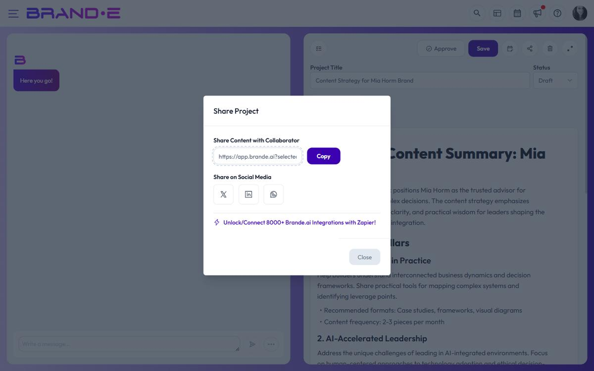

# Share and Publish Content

Sharing and publishing are different ways to get your content out. Sharing sends a project to people, and publishing puts it live on your channels. Knowing which to use helps your content reach the right people.

## Share vs. Publish: What's the difference?

**Sharing** means sending a project to people inside Brande.ai, or posting its text quickly to social media:

- Share a project link with members of your brand for review
- Send the text to X, LinkedIn, or WhatsApp from the Share window
- Good for feedback, discussion, or quick informal posts

**Publishing** means putting finished content live on your official channels, such as your website, blog, or social accounts:

- Brande.ai doesn't post to these channels from inside the app
- You publish from your own accounts by copying or exporting the content, or automate it with Zapier
- See [Publish Content to Your Channels](/section-6-collaboration/publish-to-channels)

## When to share

Use sharing when you:

- Need feedback from your team or clients before going live
- Want to gather comments on a draft
- Want to post a quick update to X, LinkedIn, or WhatsApp

## When to publish

Use publishing when you:

- Have final, approved content ready to go live
- Need the content on your website, blog, or other official channels
- Want a repeatable workflow with Zapier. For example, you could send every approved project to WordPress as a draft

## Share a project

Click the **Share** button (network icon) in the top toolbar:

1. A modal opens with two sections: "Share Content with Collaborator" and "Share on Social Media"

### Share with a collaborator (link sharing)

**Share Content with Collaborator** section:

1. A shareable link appears (URL to your project)
2. Click **Copy** to copy the link to your clipboard
3. Paste the link in:
   - Email to stakeholders
   - Slack message to team
   - Project management tool
   - Anywhere collaborators work

The link only opens for people who are already members of your brand. To share with someone new, invite them to the brand first. What they can do in the project depends on their role.

**Collaborator limits:**
- Your plan limits how many collaborators you can invite to your brands
- Sharing a link doesn't use up a collaborator seat. Only invitations do
- When you've reached the limit, the invite button on **My Plan** is disabled and its tooltip reads: "You have reached the collaborator limit, upgrade your plan"

### Share on social media

**Share on Social Media** section:

Choose from available platforms:

- **X (Twitter):** Click the X/Twitter button to share content
- **LinkedIn:** Click the LinkedIn button to share professionally
- **WhatsApp:** Click the WhatsApp button to share with contacts

When you click a platform:
1. The platform opens in a new tab
2. Your project's text is filled in. The image itself isn't attached, though an image's link may appear in the text
3. Edit the message if needed
4. Post it from the platform

This is good for quick posts. For your main channels, see [Publish Content to Your Channels](/section-6-collaboration/publish-to-channels).

## Publish to your channels

Brande.ai doesn't post to your website, blog, or social accounts directly. To publish:

- **Copy or export** the content and post it from your own accounts
- **Automate** with Zapier. The Share window links to the Brande.ai Zapier app (**Unlock/Connect 8000+ Brande.ai Integrations with Zapier!**), and you connect it with an API key from **Account → API Keys**

See [Publish Content to Your Channels](/section-6-collaboration/publish-to-channels) for step-by-step instructions.

## Export instead of sharing

If collaborators don't have Brande.ai accounts:

1. Click the download icon at the top of the document (on desktop, hover over the document to show it)
2. Choose **PDF** or **Word**
3. Send the file via email or file sharing service

This gives them a static copy they can read offline.

## Sharing security

When you share a project:
- The link is a stable URL of the form `{your-app-url}?selectedProject=[projectId]`
- Recipients still need a Brande.ai account with permission to view that brand’s projects — the link by itself does not grant access
- Recipients cannot edit the project unless they have an editor role on the brand
- The link does not expire and there is no built-in "stop sharing" or revocation button

## Manage shared access

To limit who can see a shared project, the practical levers are:
- Remove the recipient from the brand (or change their role) so the link no longer authenticates them
- Archive the project. Folders don't have their own permissions, so moving a project into a folder doesn't hide it
- Be deliberate about who you share the link with — anyone added to the brand will be able to open it

## Related Topics

- [Publish Content to Your Channels](/section-6-collaboration/publish-to-channels)
- [Manage Client Review and Approval](/section-6-collaboration/manage-client-review-approval)
- [Share Content Projects](/section-6-collaboration/share-content-projects)